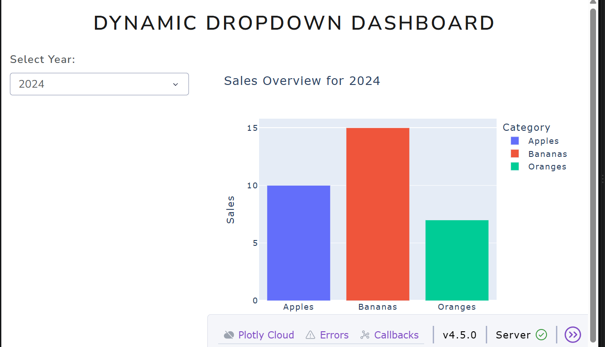

# 📊 Interactive Dash Bootstrap Dashboard

A clean, responsive web dashboard built with **Python**, **Plotly Dash**, and **Dash Bootstrap Components (LUX theme)**. It features dynamic filtering via dropdown menus and fully interactive data visualization.

---

## 📸 Preview
[cite: 1]

---

## 🚀 Features
* **Responsive Layout:** Built with Dash Bootstrap grid system (`dbc.Container`, `dbc.Row`, `dbc.Col`).
* **Dynamic Interactivity:** Filter sales metrics instantly by year using a reactive `dcc.Dropdown` callback.
* **Modern Styling:** Styled using the clean `LUX` theme from Dash Bootstrap Components.

---

## 🛠️ Installation & Setup

Follow these steps to run the dashboard locally on your machine:

1. **Clone the repository:**
   ```bash
   git clone [https://github.com/temesgen-teka4/Dashbord_usingPython.git](https://github.com/temesgen-teka4/Dashbord_usingPython.git)
   cd Dashbord_usingPython

   1,Create and activate a virtual environment (Optional but recommended):
   python -m venv venv
     # On Windows:
    venv\Scripts\activate


    2, Install dependencies:
    pip install -r requirements.txt


    3,Run the application:
    python Dashbord.py

    4,Open in browser:
Navigate to http://127.0.0.1:8050/ in your web browser


  Code Structure
  Dashbord.py — Main application logic, layout configuration, and callback functions.   
  requirements.txt — Project Python package dependencies.  
  screenshot.png — Visual preview asset for the repository[cite: 1].